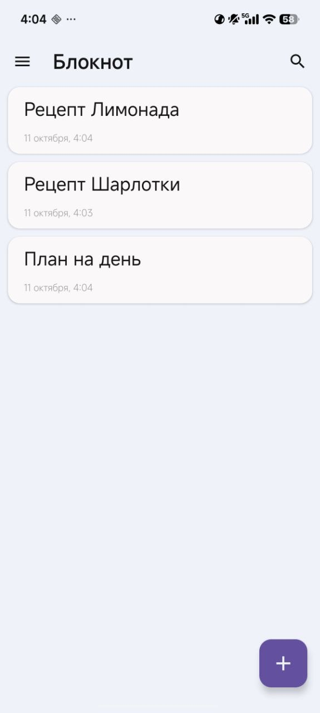
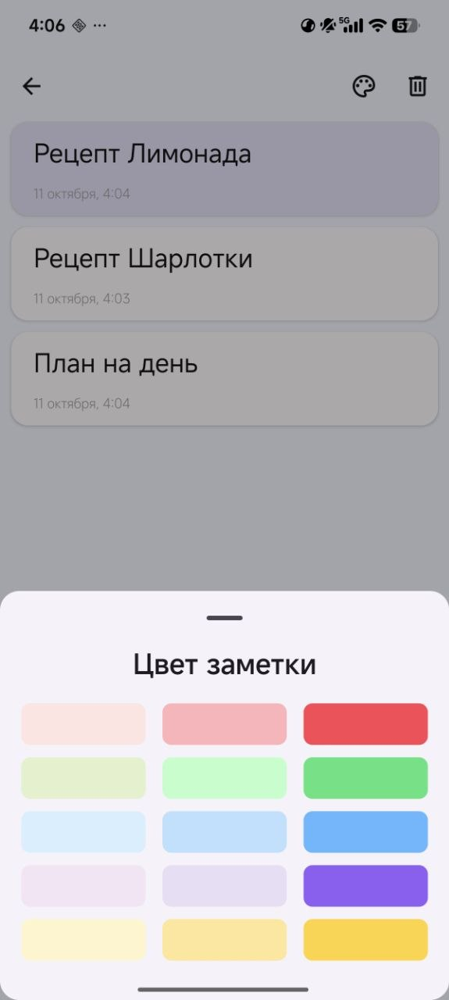
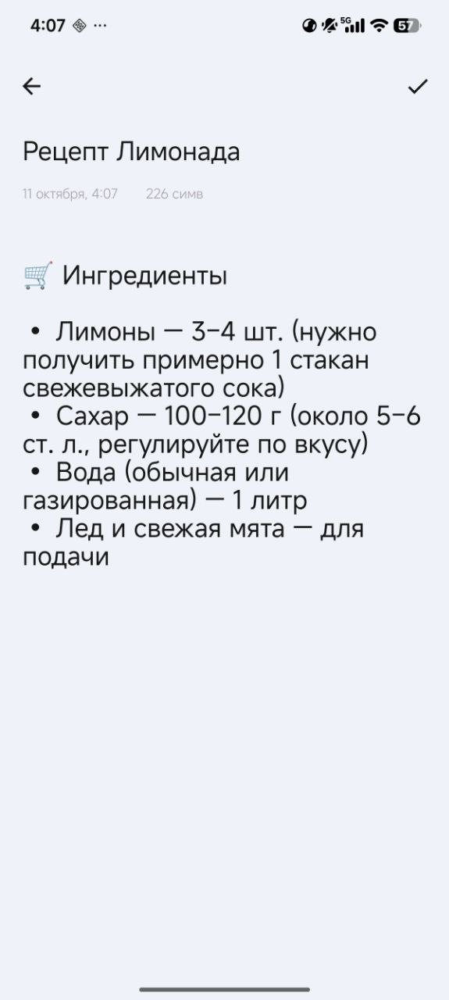
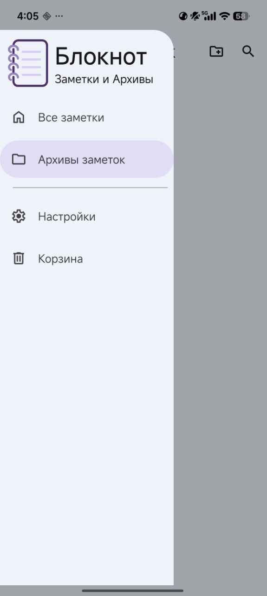
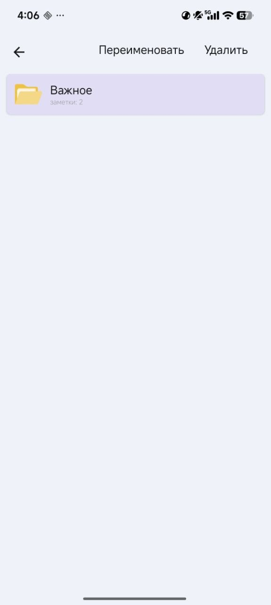
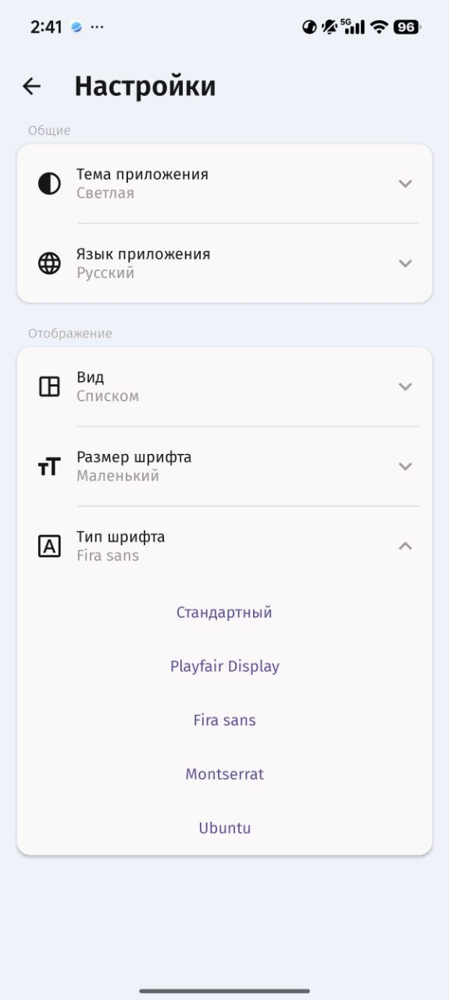

# Блокнот — Кастомизируемые заметки для Android
> Современное и гибкое приложение для создания заметок с акцентом на типографику, визуальное разделение цветом и удобную файловую организацию.
> [](https://kotlinlang.org)
[](https://developer.android.com)
[](https://developer.android.com/jetpack/compose)
[](https://m3.material.io)

## Скриншоты
<div style="display: flex; justify-content: space-between; align-items: center; width: 100%;">
  
  
  
</div>
<div style="display: flex; justify-content: space-between; align-items: center; width: 100%;">
  
  
  
</div>

## Ключевые возможности
### Гибкая настройка интерфейса
* **Кастомная типографика:**  Выбор шрифтов (*Playfair Display*, *Fira sans*, *Montserrat*, *Ubuntu*
* **Размер шрифта:**  Настройка масштаба текста (маленький, средний, большой)
* **Сетка отображения:**  Переключение вида заметок под себя — в 1 колонку (списком), в 2 колонки или в 3 колонки
* **Темы оформления:**  Поддержка светлой, тёмной и системной темы.
* **Цветовое выделение:**  Палитра цветов для выделения заметок

### Организация и управление заметками
* **Архивы заметок:**  Группировка заметок по именованным папкам с возможностью создания, редактирования и удаления
* **Корзина:**  Место для хранения удаленных заметок с возможностью восстановления или окончательной чистки
* **Счётчик символов и дата:** отображение даты создания и объёма текста заметки в реальном времени.

### Мультиязычность и приватность
* **Локализация:** Поддержка русского и английского языков прямо в настройках
* **Локальная база данных:** Все данные хранятся локально на устройстве и не уходят в сеть

## Стек технологий

* **Язык разработки:** [Kotlin](https://kotlinlang.org/)
* **Пользовательский интерфейс:** Jetpack Compose, Material 3
* **Хранилище заметок:** Room Database (SQLite)
* **Хранилище настроек:** SharedPreferences
* **Архитектура:** MVVM (Model-View-ViewModel) + StateFlow
* **Асинхронность:** Kotlin Coroutines & Flow

---

### Требования
* Android Studio (Ladybug / Hedgehog или новее)
* JDK 17+
* Минимальная версия Android: API 26 (Android 8.0)

## Установка
Клонируйте этот репозиторий и импортируйте его в **Android Studio**.
```bash
git clone https://github.com/Sh1den/NoteBook.git
cd NoteBook
```
